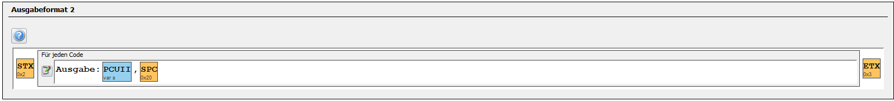
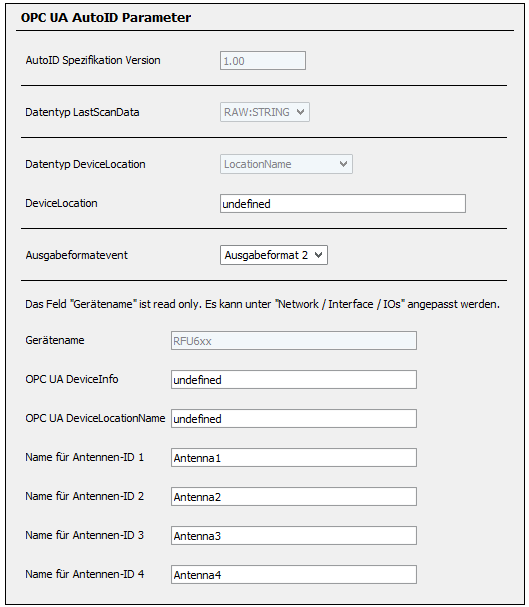
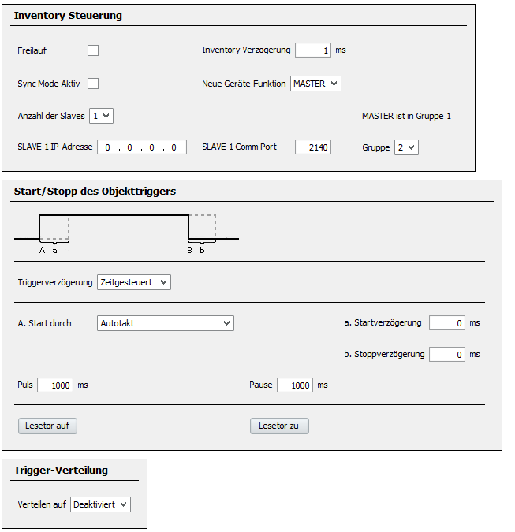

# Format-RFIDParts

**RFID Format Management Platform**

A web portal for visualizing and managing RFID-tagged machine format parts. Technicians and engineers can assign RFID tags, validate status, and check configurations before production. The system consists of a modern Next.js frontend and a Python FastAPI backend with persistent SQLite database.

---

## Project Overview

- **Frontend:** Next.js
- **Backend:** Python, FastAPI, SQLite (persistent assignments)
- **Networking:** Nginx
- **Container:** Multi-stage Docker build, runs as a single container
- **CI/CD:** GitHub Actions (Build, Test, Security, Release)
- **Features:**
  - Assign RFID tags to format parts (persisted)
  - Visual validation & status display
  - Somic branding
  - OPC UA & WebSocket integration

---

## Local Development Setup

1. **Clone the repository**
   ```bash
   git clone <repo-url>
   cd Format-RFIDParts
   ```
2. **Install dependencies**
   ```bash
   npm ci
   # or
   npm install
   ```
3. **Set up Python virtual environment (recommended)**
   ```bash
   cd backend
   python -m venv .venv
   source .venv/bin/activate  # On Windows: .venv\Scripts\activate
   pip install -r requirements.txt
   cd ..
   ```
4. **Create your .env file** (see `.env.example`)
   ```bash
   cp .env.example .env
   # Adjust variables if needed (e.g. OPC_UA_SERVER_URL, DATABASE_URL)
   ```
5. **Start the development servers**
   ```bash
   npm run start:all
   # This will start both frontend and backend in parallel
   ```
6. **Open the frontend:**
   [http://localhost:3000](http://localhost:3000)

---

## Docker (Build & Run)

1. **Build the image:**
   ```bash
   docker build -t format-rfidparts .
   ```
2. **Start the container (HTTP debug ports):**
   ```bash
   docker run -d -p 3000:3000 -p 8001:8001 --env-file .env.example -v $PWD/data:/app/data format-rfidparts
   ```
   or enable HTTPS via bundled Nginx reverse proxy on port 443:
   ```bash
   docker run -d -p 443:443 --env-file .env.example -v $PWD/data:/app/data format-rfidparts
   ```
   Certificates under `certs/` are copied into the image. Adjust `SERVER_IP` to match your host.
3. **Or with Docker Compose (HTTPS on :443 + debug ports):**
   ```bash
   docker-compose up --build
   ```

---

## Developer Guide

- **Frontend:**
  - Entry point: `src/app/somic/page.tsx`, `public/somic.html`, `public/features.js`, `src/app/customer/page.tsx`
  - API calls: `src/lib/api-client.ts` (uses `NEXT_PUBLIC_BACKEND_URL`)
  - UI components: `src/components/`, styling in `public/somic.css` and `src/app/globals.css`

- **Backend:**
  - Entry point: `backend/main.py` (FastAPI)
  - DB logic: `backend/simple_assignment_db.py` (SQLite, async SQLAlchemy)
  - API routes: `/api/assignments`, `/api/format-parts`, `/api/formats`, ...
  - WebSocket: `/ws/opc-ua` (OPC UA integration)
  - Configuration: `.env` or environment variables

- **Persistence:**
   - All RFID assignments are stored in `data/assignments.db` (created automatically on first start)
   - Cached customer HTML is stored at `data/customer-html-cache.html` (shared between frontend and backend)

- **Testing:**
  - Frontend: `npm run lint`, build check

- **CI/CD:**
  - See `.github/workflows/` for build, deploy, and security workflows

---

## API Endpoints (Backend)
[API-Endpoints](/backend/API.md)

## Frontend Pages & Views

| Page/Route                | Description                                      |
|--------------------------|--------------------------------------------------|
| `/`                      | Main page, overview, format part assignment      |
| `/customer`              | Customer view, reduced UI                        |
| `/somic`                 | Somic branding, special customer view            |
| `/api/*`                 | API endpoints (see above)                        |
| `/public/somic.html`     | Legacy/standalone UI (direct access)             |

---

## Notes for New Developers

- **.env.example** contains all required variables for local development and production.
- **Backend and frontend run in the container on separate ports (3000/8001).**
- **All assignments are persisted in SQLite** (volume `./data:/app/data`).
- **The frontend API client always uses the URL from `NEXT_PUBLIC_BACKEND_URL`.**
- **OPC UA and WebSocket are optional and can be disabled via `.env`.**
- **Questions?** → See code comments and the `README.md` in the backend folder.

---

## Antenna Configuration

- Ausgabeformat (RFID Tag Data):



- OPC UA Settings:



Don't forget to turn on the OPC UA server in your RFID reader!

- Objekttrigger (Object Trigger) settings:



- Export PDF:

[Export PDF](graphs/RFU630E.pdf)

## License

(c) Somic Verwaltungs GmbH, 2025. Proprietary. For internal use and customer projects only.
